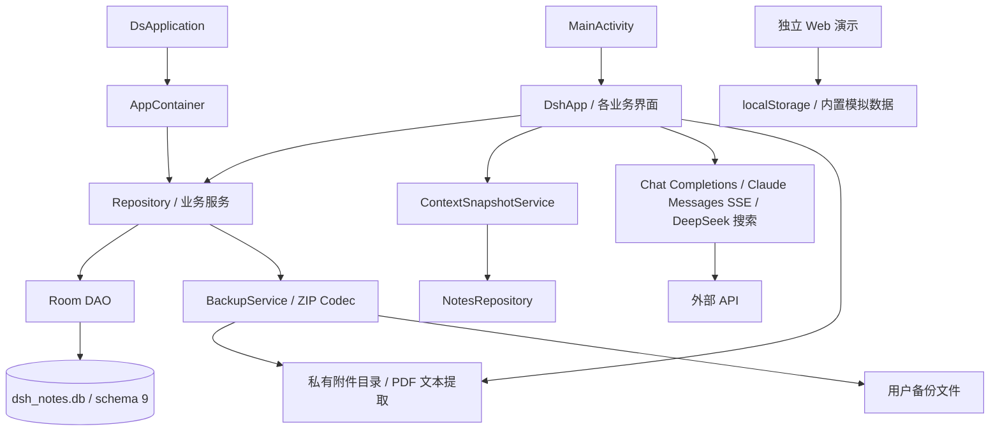

# 架构

基准：2026-11-06 只读审计及本轮源码复核。工程状态及证据来源见 [current-state](docs/current-state.md)，功能边界见 [product](docs/product.md)。

## 当前架构

原生 Android 与 Web 演示是两套独立实现。Android 只有一个 Gradle `:app` 模块；`ui`、`data`、`data/notes` 是包边界，不是独立构建模块。Kotlin、Compose、Material 3、Room、Coroutines/Flow 和手写 HttpURLConnection/SSE 构成当前实现，未发现独立后端。

入口由 [Manifest](android/app/src/main/AndroidManifest.xml) 指定：[DsApplication](android/app/src/main/java/com/dspro/android/DsApplication.kt) 创建 [AppContainer](android/app/src/main/java/com/dspro/android/AppContainer.kt)，[MainActivity](android/app/src/main/java/com/dspro/android/MainActivity.kt) 渲染 [DshApp](android/app/src/main/java/com/dspro/android/ui/DshApp.kt)。容器手工组装共享数据库、Repository、上下文、搜索、导入及备份服务。笔记列表有 ViewModel；聊天和跨屏业务主要在根 Compose 函数编排。不能据历史方案声称已采用统一 MVI、Navigation Compose 或 DataStore。

### 数据流

- 笔记输入经 NoteDocument，延迟保存到 Repository 和 DAO，更新正文及链接；版本另存 revisions。证据：[编辑器界面](android/app/src/main/java/com/dspro/android/ui/notes/NoteEditorScreen.kt)、[Repository](android/app/src/main/java/com/dspro/android/data/notes/NotesRepository.kt)。
- 聊天校验配置及引用，固定笔记/附件快照，保存消息及草稿状态，再组合历史、项目指令、记忆和可选搜索资料，接收 SSE 并保存增量。v0.3.0 Claude 和终态处理已有离线候选代码；设备及在线验收尚未确认。v0.4.0 目录实体已增加项目与父目录 scope，并统一写入校验；schema 迁移、旧备份转换和界面改动的离线证据见 [实施任务](docs/exec-plans/T-20261107-v040-implementation.md)。
- 备份恢复先校验归档与关系、暂存附件，再在数据库事务内替换业务表和路径，提交后清理旧附件。证据：[BackupService](android/app/src/main/java/com/dspro/android/data/notes/BackupService.kt)。

### 耦合点

DshApp 同时负责导航、请求、草稿、附件及内容生命周期（审计时 2,097 行）。Repository 通过同一数据库访问其他领域 DAO；删除文件夹影响笔记、对话和临时草稿，删除项目移动内容并删除项目记忆。备份直接依赖 13 张表及上下文 JSON。Markdown 规则分布于编辑转换、解析和渲染；上下文拼装也有多处实现。完整符号级循环依赖分析尚未进行，循环依赖状态为「未确认」。

## 目标架构方向（待后续实施，不是已落地状态）

先保持现有技术栈与单模块，建立可复现质量基线，再按已存在职责明确聊天/草稿、编辑器、持久化与备份的接口；一次只整理一条可回归链路。是否拆 Gradle 模块、采用何种新模式均未决定，不在本阶段预设。具体顺序和验收见 [执行计划](docs/exec-plans/000-project-reboot.md)。

上述耦合链同时是多会话协调和测试选择边界，执行 [会话规则](docs/workflow.md) 与 [质量矩阵](docs/quality.md#按变更选择检查)。先用现有脚本验证行为，不以建立新框架或搬目录作为重启完成条件。

## 已确认约束

- 应用身份 `com.dspro.android`、数据库名 `dsh_notes.db`、历史迁移 1→9 及备份兼容性必须保护；schema 9 的目录映射按 scope 拆分旧共享目录，具体验收证据见 v0.4.0 实施任务。
- Room 当前 `exportSchema=false`，schema 历史尚未独立导出。证据：[NotesDatabase](android/app/src/main/java/com/dspro/android/data/notes/NotesDatabase.kt)。
- 应用启动调用 `cleanupTrash(30)`；不能在真实用户数据上把启动当作只读检查。
- 完整业务备份排除 API 配置，恢复是替换而非合并。见 [ADR-0001](docs/decisions/0001-backup-excludes-api-config.md)。
- Web 原型不是原生生产能力；真实模型、搜索与设备交互尚无本轮端到端验证。
