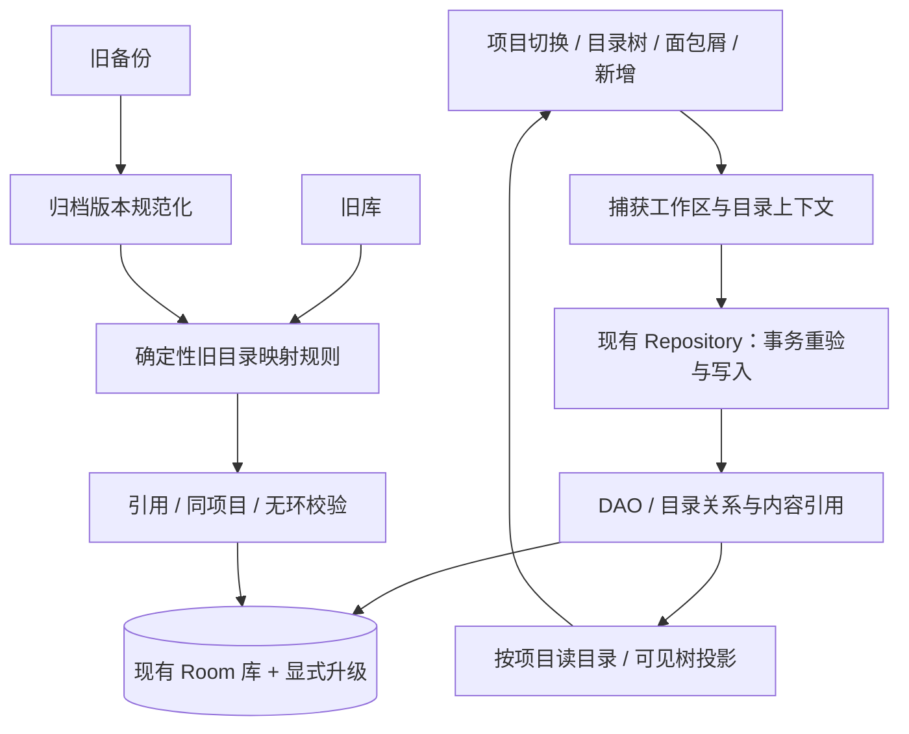

# 内容管理正式开发方案：项目目录树与工作区入口

日期：2026-11-07（Asia/Shanghai）。状态：待决定（方案编制与静态依赖审查完成；产品规则待确认）。负责人 / 集成人：本聊天 Codex（内容管理 开发计划），已停止写入并释放本文件与索引范围；本轮未实施业务代码。

## 任务与授权

用户要求：“根据已经完成的需求与技术验证报告，为布谷笔记制定下一版本的正式开发方案”。本任务对应[内容管理需求](T-20261107-folder-project-intake.md)与[技术研究](T-20261107-folder-project-research.md)。本次允许静态复核、方案与任务索引；没有据此确认草案中的产品选择、开启编码、改备份兼容或操作真实数据。

最小步骤：核对证据与版本依赖 → 给出推荐产品规则、接口与兼容方案 → 拆分工作包和验收门槛 → 文档与保护校验 → 交接。完成标准是方案可审查、可接手，明确待决定事项；不将研究结论或规划完成写成软件验证通过。

起始 `main / 708a7f0`，暂存为空。已有 `.gitignore`、任务索引、workflow、检查工具、自检及未跟踪 Skills、需求、研究、AI 规划与实施文档全部保留。开工查询桌面，同目录其他相关聊天均空闲，既有任务已声明停止写入；该观察不能证明外部工具或后续会话不会写入。索引前副本和 194 个既有文件哈希位于 `/var/folders/yx/j5kr4x4x6pgdh00c0kgrjbmr0000gn/T/bugu-folder-plan-634f1hgb/`，仅为本轮临时比对依据，不是持久备份。

允许修改：本文件、[任务索引](README.md)中本任务行及原来落在表外的内容管理需求行位置。排除：业务代码、测试工具、其他任务正文、当前产品/架构状态、版本配置、ADR、品牌原件与哈希清单、Git 提交/分支/远端操作。

回退：核对后续差异后，仅撤销本文件及索引本次增量；不恢复整份索引或覆盖既有修改。

## 版本定位与证据边界

目标：让文件夹真正属于项目，支持嵌套与结构浏览，并让新增入口、项目切换和品牌主题表达同一工作区上下文。

建议作为 **v0.3.0 之后的内容管理版本（候选 v0.4.0，待确认）**。当前磁盘软件仍为 v0.2.1 / versionCode 13、Room schema 8；[v0.3.0 AI 规划](T-20261107-v0.3.0-plan.md)与[其实施记录](T-20261107-v31-implementation.md)另有范围，当前停在协议前置且声明停止写入。本方案不覆盖、合并或重命名 AI 任务。若用户要求合为同一版本，须先重排范围、数据与聊天集成验收；不能直接沿用 AI 方案“不改 schema/业务备份”的约定。

版本号、versionCode 和新 schema 编号在实施开工时按实际集成基线确定，不预占 9 或 14。计划完成不改变软件版本。默认 Android 原生；Web 原型保持独立演示，不纳入本次建议范围。

| 依据 | 已知事实 | 对方案的约束 |
| --- | --- | --- |
| [需求草案](T-20261107-folder-project-intake.md) | 六组产品选择仍待确认 | 本文件给出成套建议，不回写为用户已确认 |
| [技术研究](T-20261107-folder-project-research.md) | 官方资料与源码层面存在可行路径；没有候选编译、迁移或设备实验 | 可用于设计选型，不能称技术实测通过；本轮未重新核查外部滚动文档 |
| [实体](../../android/app/src/main/java/com/dspro/android/data/notes/NotesEntities.kt)、[NotesRepository](../../android/app/src/main/java/com/dspro/android/data/notes/NotesRepository.kt) | 文件夹没有 projectId/parentId，笔记、对话与临时草稿已有归属字段；部分写入只验证目录存在 | 必须调整数据不变量和所有写入入口，不能只按项目过滤 UI |
| [ProjectsRepository](../../android/app/src/main/java/com/dspro/android/data/notes/ProjectsRepository.kt) | 删除项目把笔记/对话移到全局并删除项目记忆；未有目录树和临时草稿冲突策略 | 删除规则要覆盖新目录与隐藏内容，明确保留现有记忆删除语义及其风险 |
| [BackupService](../../android/app/src/main/java/com/dspro/android/data/notes/BackupService.kt) | ZIP format version 1，当前接受 databaseVersion 6..8；恢复会替换业务数据 | Room 升级和旧 ZIP 转换分别实现、共同验证；新备份不能伪装旧数据库版本 |
| [当前状态](../current-state.md)、[质量规则](../quality.md)、[ADR-0001](../decisions/0001-backup-excludes-api-config.md) | 有本机隔离质量基线；完整历史/设备链未完成；业务备份排除 API 配置 | 继承实际覆盖限制，不读取真实凭据、不宣称所有旧库已验证 |

沿用现有 Kotlin、Compose、Room 2.6.1、Flow、手工 AppContainer 与单一 :app。研究推荐的“现表新增项目和父节点”作为本方案候选；不新增依赖、后端、文件系统同步或架构模式。

## 建议交付范围与产品规则

下表全部是**待确认的实施标准建议**。确认后再同步需求任务，避免需求、方案与实施验收各用一套规则。

| 编号 | 能力与建议规则 | 可观察的验收结果 |
| --- | --- | --- |
| F01 | 每个项目有独立目录树；保留单独“全局”工作区，projectId=null 只表示全局，不表示迁移未完成。全局不汇总其他项目目录 | A/B 项目和全局可各有同名目录；切换后只显示当前 scope 的目录及内容；空目录也独立存在 |
| F02 | 支持顶层/子目录、改名、展开折叠、面包屑及逐级返回；同父节点按 sort、名称、ID 稳定排序。同名不合并，以 ID 定位 | 折叠只影响树展示；进入目录展示其直接子目录和直接内容；搜索保留当前项目全范围，不暗改为递归目录搜索 |
| F03 | 窄屏用结构抽屉，宽屏复用侧栏；树与内容区共享选中目录。展开状态按项目保存于界面状态，进程恢复先校验 ID；缺失状态回到根 | 返回先关闭抽屉，再按现有导航逐级离开目录；失效目录回根并提示，不产生隐藏选择；宽窄屏临界值在 C00 布局稿固定 |
| F04 | 主资料库工作区新增入口放在内容区标题/面包屑右侧，移出品牌/项目顶栏；目录行菜单可“新建子文件夹/笔记/对话”，共用逻辑 | 根级新增归当前项目根；目录内新增归当前目录；弹窗标明目的地。归档、回收站、搜索结果态不提供含糊的就地新增；返回资料库后再创建 |
| F05 | 工作区顶部项目切换器相对整个内容栏几何居中，左右动作区等宽；Logo 在品牌区，项目名称长时省略并可查看全名 | 两侧按钮数量不同、长名、大字与侧栏切换时仍按内容栏居中；不承诺相对包含侧栏的整块物理屏幕居中 |
| F06 | Logo 先适配容器主题色，保留原图；如仍有明显浅底割裂，再提交独立暗色衍生稿审查 | 浅/深色、手动/系统主题切换无需重启；品牌原图及现存资源不覆盖。若需新图，未获视觉确认不能把 F06 勾为完成 |
| F07 | 支持同项目内目录改挂父级；拒绝自环、后代作为父级和跨项目父节点。首版暂不提供跨项目整棵子树移动 | 移动后子树 ID 和内容归属不变，选择/面包屑更新；不新增拖放。既有单篇笔记/对话跨项目移动保留，按下表清理或重选目录 |
| F08 | 目录删除采用“删除此文件夹，内容移到父级、直接子目录提升一级”，目录本身无回收站；不批量删除笔记/对话 | 确认框显示直接内容/子目录及隐藏内容数量；根目录的内容移到项目根。原笔记/对话的归档、回收站状态不变，无附件清理 |
| F09 | 文件夹归档按祖先状态形成有效归档，不批量改写后代原有 archivedAt；归档入口可定位整条祖先路径 | 普通树隐藏有效归档分支，归档视图可访问其中内容；恢复父目录不恢复本来独立归档的子目录。恢复内容时若祖先仍归档，明确提示其所在位置 |

F04/F05 是对“新增按钮不合理、项目居中”的明确解释，尚不是用户确认的布局。C00 至少提供窄/宽屏、空项目、嵌套目录、长名与明暗两套状态稿，先验收布局再落代码；可使用代码或文档草图，不引入新设计工具作为依赖。

### 涉及内容归属的统一规则

| 操作 | 建议行为与保护 |
| --- | --- |
| 单篇笔记/对话跨项目移动 | 在同一事务中设置目标项目和用户明确选择的目标目录；未选目录则 folderId=null。不得残留旧项目目录；正文、消息、版本、附件和已发送上下文快照保持原值。未发送的笔记引用在再次发送前重新做目标项目校验 |
| 创建弹窗期间切项目、目录被删/归档 | 捕获弹窗打开时的项目/目录，提交时事务重验；上下文变化则拒绝并让用户重选，不偷偷落到新项目或父级。正在编辑的已存在笔记按自身归属保存，不能用当前浏览项目覆盖 |
| 项目归档/恢复 | 维持现有项目归档语义，不批量改子目录/内容状态；进入已归档项目时新增禁用，恢复后原目录树及独立归档状态保留 |
| 项目删除 | 建议保留既有“内容移全局、删除项目记忆”语义，并将整棵目录树移到全局且保持 ID/父子关系，根目录不按名称合并。显示内容/目录/记忆数量及记忆将删除的提示；归档/回收站内容一并迁移 |
| 项目删除与草稿/在途请求冲突 | 若有在途请求、未保存编辑或有内容的项目临时草稿，先拒绝删除，用户完成保存、停止或明确处理草稿后重试。不将项目临时草稿合并进全局临时草稿，不覆盖全局草稿；项目删除事务内再次检查。空草稿按定义清理，不以隐藏草稿为已无数据 |
| 有会话的草稿、隐藏内容 | 会话草稿随 sessionId 关联；临时草稿按原 projectScope 保留。删除/移动目录要处理二者关联和内存待提交状态；收到旧目录回调时重新校验。恢复笔记/对话不得绕过同项目约束 |

项目删除会改变项目上下文，且仍删除项目记忆，不能被包装成无损操作。若用户希望改为项目回收站或保留记忆，需另行调整本表、schema/备份评估与验收，不能顺手实现。

暂缓：Web 同步改版、跨项目整树移动、拖放/自定义排序、目录回收站、递归文件管理、磁盘双向同步、闭包表/路径存储、自动整理、云协作、编辑器重构和 AI 需求扩展。归档、已有单篇移动及项目删除虽非新诉求，却是数据模型变更必需覆盖的兼容链，不能留给发布后处理。

## 逻辑职责与接口契约

以下为拟议接口语义，类型名不是固定实现要求。按已有包边界做最小改动，不创建通用资源管理框架。

图中“映射规则”表示一致的规范与 fixture；Room SQL 和 JSON 转换可以分别实现，不为代码复用强造新框架。两条链必须对同一输入得到相同目录映射。

| 边界 | 输入/输出与约束 | 主要影响文件 |
| --- | --- | --- |
| 目录模型 | 在 FolderEntity 增加可空 projectId、parentId；父节点为空表示根，项目为空表示全局。查询索引按项目/父节点设计，并与新建 schema、迁移结果一致 | NotesEntities、NotesDatabase、NotesDao |
| 工作区上下文 | 创建操作传显式 projectId、folderId；目录创建另传 parentId。所有 ID 必须事务内重验，不以 null 静默替换无效非空 ID | NotesRepository、ChatRepository、MarkdownImportService、NotesViewModel、DshApp |
| 目录读取与树投影 | 一次按 scope 读取，构建 parent→children；迭代遍历并检测 visited，按展开集形成稳定 ID 的可见行。无逐行数据库查询或无限递归 | NotesDao、现有 UI 状态、LibraryScreen |
| 目录写入 | createFolder(scope,parent,name)、moveFolder(id,parent)、deleteFolder(id)、archiveFolder(id,state) 等语义；写入前验证存在、同项目、无环、有效归档状态，多对象操作一个事务 | NotesRepository 及必要共用的内部校验 |
| 内容写入 | 创建、Markdown 导入、保存草稿、首条消息事务、改目录、跨项目移动、恢复均适用同项目约束；不得仅修改 UI 参数而遗漏旧入口 | Notes/Chat Repository、DAO、导入/草稿链 |
| 项目删除 | 移目录及内容、处理空临时草稿、删除记忆/项目一个事务；失败全部回滚。不能用新外键级联代替产品规则 | ProjectsRepository、相关 DAO |
| 备份读取 | 按 databaseVersion 区分旧平铺与新目录模型，先规范化、映射和完整校验，再进入现有暂存/事务恢复流程 | BackupService；ZIP Codec 原则上不变 |
| 视觉与导航 | 项目选择、选中目录、展开集和面包屑按 scope 隔离；Logo 跟随 Dsh.dark，核对手动主题与系统配置差异 | DshApp、LibraryScreen、Components、Theme、必要衍生资源 |

引用完整性至少包含：父目录存在且同项目；目录树无环；非空项目存在；notes/chat_sessions/temporary_chat_drafts 的非空 folderId 存在且同 scope；临时草稿 projectScope 与 projectId 一致。chat_drafts 通过 sessionId 继承归属。归档、回收站不豁免这些不变量。只验证外键存在或界面不可选都不充分。

搜索、双链和 AI 上下文继续使用既有项目边界，不把同名目录当内容身份；不在目录迁移时重建已发送 contextSnapshot。已知同名双链的历史风险不在本任务顺手修复，但因本次改动产生的新跨项目引用必须阻止。

## 旧目录映射与数据库升级方案

推荐采用**按实际引用 scope 拆分旧共享目录，空目录归全局**，不把旧内容改归某个项目。下列算法须在 C00 获确认，C01 补充可恢复证据并批准兼容变更后才能编码。

1. 对每个旧 folderId，扫描全部 notes、chat_sessions、temporary_chat_drafts，包括归档、回收站和空白但已持久化的对象，求引用 scope 集合；projectId=null 是 global。仅存在 sessionId 的草稿跟随会话，不另造 scope。无引用的目录按 global 处理。
2. 每个 `(oldFolderId, scope)` 生成一个根目录，保留 name/sort/archivedAt，parentId=null；若有 global 则 global 保留旧 ID，否则在按项目 ID 稳定排序的第一个 scope 保留旧 ID。其余克隆 ID 按明确编码的旧 ID+scope 确定性派生，并与所有已用 ID 检测冲突，冲突走确定性序号；不靠随机顺序分配。
3. 每个引用对象只按其原 projectId 重映射 folderId。笔记/会话/草稿 ID、正文、消息、版本、记忆、附件、项目和上下文快照不变；内容时间戳也不因自动迁移重写。目录数允许增加，其他业务表行数应保持不变。
4. 生成旧→新映射及各 scope 计数供合成测试审查；实施记录不得输出真实目录名/正文。升级结果给用户简短说明“共享文件夹已按项目拆分，空文件夹保留在全局”，不增加永久“待整理”伪 scope。
5. 输入存在悬空项目/目录或不合法 scope 时，停止该升级/恢复并保留原状态，不猜测、删除或跨项目修补。C01 必须覆盖此失败场景和可恢复提示；真实历史数据是否出现过此情况仍未确认。

例：旧目录 D 同时有项目 A 笔记、项目 B 的回收站会话和全局临时草稿，升级后生成 A/D、B/D、全局/D 三个根目录；三个对象各留在原 scope，回收站状态不变。没有内容的 E 只保留全局/E。此例是合成验收用例，不是真实数据观察。

数据库实施要求：保护准确的旧 DDL/索引，保留全部历史迁移，在实际前序版本后新增手动迁移；新建库与升级库逐列/索引对照，禁止 destructive migration。迁移插入、映射、更新与校验须原子化，错误不得留下半升级。全量 1→当前链缺少可信夹具的部分明确列为未验证，不因 6/7/8 合成通过声称覆盖所有历史库。

## 业务备份兼容与回退准备

建议继续使用 `dspro-user-backup` format version 1，由实际 databaseVersion 区分语义；新增字段属于同一表的增量，先证明 ZIP 结构与版本拒绝机制足够。若 C01 发现必须改变容器结构或无法安全区分，应停下另提 format 版本方案，不边写边定。API 配置继续排除，Android 系统备份仍遵循 AI/工程任务的既有边界，本任务不重新设计凭据存储。

| 方向 | 承诺建议与验收 |
| --- | --- |
| 新应用读取旧备份（databaseVersion 6/7/8） | 先沿用原版本缺列规范化，再按上述规则拆分目录；与相同旧数据的 Room 升级结果对照。若实施基线已有更高版本，还须列出其格式并补对应转换 |
| 新应用读取新备份 | 保留目录 ID、projectId、parentId、顺序与归档字段，完整验证项目、父节点、环、内容 scope 及全部引用后恢复；不再次执行旧目录拆分 |
| 旧应用读取新备份 | 明确拒绝高 databaseVersion；在写库/附件前失败。旧版恢复端也需隔离合成演练，不能承诺降级兼容；不伪报 databaseVersion |
| 恢复失败 | 错误引用/环/缺附件/SQL 中途失败/暂存写失败，均保持旧业务库和旧附件；未提交暂存清理，已提交附件不能被失败清理误删 |
| 新版往返 | 导出→隔离恢复后核对所有业务表内容、目录树、归档/回收站、草稿及附件校验；路径可重写，但引用对应关系与字节哈希一致 |

回退准备分两层。代码与合成测试用可追溯源文件副本/本地基线重建，逐项撤销本任务改动，不依赖未授权提交。数据回退必须在升级前保留已验证可恢复的旧版业务归档、匹配旧版安装包及身份/签名证据；如有获准的数据库快照，必须连同附件与一致的 SQLite 状态整套保存，不能运行中单拷主 db。当前没有为真实用户准备这些材料，本文件不是“已可回退”的证明。

C01 应先在隔离设备以合成数据证明：旧版导出及恢复可用、升级失败不损数据、成功升级后仍能在另一个隔离旧版环境恢复升级前归档。降级 APK 直接打开新库不受支持；升级后新增/修改的数据不会自动进入升级前归档，也不承诺无损逆向合并。真实覆盖安装、恢复替换或凭据操作另列具体方案，用户批准后才执行；开发阶段不得为做演练而启动真实应用。

## 工作包、依赖与完成门槛

本表是规划，不提前建立空实施任务、不认领业务文件。默认同一目录一个写入会话，内容管理集成人负责最终验证；与 AI 工作共用 DshApp、草稿、项目和回归链，必须串行集成。独立工作副本和并行开发另核授权。

| 工作包 | 前置 | 实施范围与产物 | 完成门槛 |
| --- | --- | --- | --- |
| C00 范围与交互定稿 | 本方案 | 确认 F01—F09、旧目录拆分/空目录归全局、删除/草稿策略、平台与版本顺序；补布局状态稿和工作区导航说明 | 用户确认产品规则；需求任务更新为可追溯确认，业务实施授权单独记录。未确认前仅可继续文档 |
| C01 兼容契约与保护准备 | C00、实际集成基线明确 | 列所有写入点/旧版本 DDL、目录映射 fixtures、备份兼容表、旧版恢复和回退材料；确定新 schema/备份版本、冲突 ID 编码及性能验收预算 | 数据/备份兼容方案可审查，保护材料有校验与恢复证据；先核对开启产品开发及兼容变更的明确批准，再改兼容代码 |
| C02 数据升级与备份转换 | C01 门槛关闭 | Entity/DAO/迁移、旧备份规范化、新备份验证；新建/升级 schema 对齐与异常回滚测试 | 6/7/8 到新版本、旧备份与新备份往返、旧版拒绝、无效输入及失败回滚通过；迁移与备份作为一个集成批次，不交付半套 |
| C03 业务归属与生命周期 | C02 | 创建/导入/保存/草稿/首消息/移动/归档恢复/目录删除与项目删除统一校验和事务 | 全部入口覆盖同项目、无环及隐藏数据；切项目、删除时的弹窗/内存草稿、全局草稿冲突不串用；内容与附件无意外变更 |
| C04 目录树与工作区入口 | C03；C00 视觉确认 | 稳定树投影、窄屏抽屉/宽屏侧栏、面包屑、上下文新增、项目居中与状态恢复 | F01—F05/F07 的离线状态与设备交互验收通过，目录不可达/循环输入可诊断；不靠 UI 掩盖数据无效 |
| C05 品牌与主题 | C00；串行接在 C04 后 | 主题容器；必要时经批准新增暗色衍生资源 | F06 明暗视觉通过，品牌原件哈希不变；衍生资源单独登记，未获准不得改资产校验基线 |
| C06 集成质量与升级演练 | C02—C05；AI 已有改动串行集成完成 | 最终同源 baseline、目录专项回归、合成设备升级/恢复、性能与无障碍；更新产品/架构/质量和实际必要 ADR | 必要检查通过，设备与数据兼容有可复现证据；AI 请求/取消/草稿路径不退化。只完成离线部分则标候选，不能写全部验收完成 |
| C07 用户验收与交付 | C06、剩余验证条件落实 | 用户检查目录、入口、居中与暗色体验；记录版本/APK 哈希/公有签名核对/限制/恢复说明 | 用户体验验收与交付目标明确；未授权不安装覆盖真实应用、不发布/推送。公开发行资格/签名另行处理 |

关键路径：C00 → C01 → C02 → C03 → C04 → C05 → C06 → C07。AI 端点/API 协议不是目录算法的技术前置；但共用源码集成顺序是前置。建议先让 v0.3.0 固定可追溯交接基线，再开启内容管理业务写入；若 AI 长期停在在线门槛，可由用户确认先交付内容管理，重新分配版本和集成基线，不静默抢占。

不承诺尚无证据的工期。C01 盘点入口、夹具与环境后再估时；代码完成、离线通过、设备通过、用户验收分别记录，不能用一个“完成”替代。

## 验证矩阵与放行规则

以下都是未来必须执行的验证，**本次尚未执行**。优先扩展既有生产代码回归，不写只复述新实现的测试，不依赖旧 build 生成类。

| 验收组 | 必测输入/操作 | 必要证据 |
| --- | --- | --- |
| 数据映射 | 空目录、单 scope、A/B/global 共享、相同目录名、克隆 ID 冲突、仅归档/回收站/临时草稿引用、悬空引用 | 逐条映射与行数核对；除目录/引用字段外业务数据一致；SQL 与旧 ZIP 规范化结果一致；失败无半写入 |
| 迁移/备份 | 6/7/8 合成旧库和备份、新建/升级 DDL、往返、环/跨项目父节点/重复 ID、缺附件、SQL/暂存失败 | 版本矩阵、真实执行的迁移 SQL、数据库/附件前后哈希、事务失败断言和旧版拒绝证据；无夹具版本列未验证 |
| 内容生命周期 | 各创建/导入/保存入口、临时与会话草稿、首消息、单篇跨项目移动、目录改挂/删除、归档恢复、项目删除 | 不能跨 scope 保存或复活失效目录；隐藏内容保留；项目记忆删除符合确认规则；全局草稿不覆盖 |
| 并发状态 | 新增弹窗期间切项目/删目录、编辑期间移动、在途消息/迟到回调、进程恢复、祖先归档 | 事务重验与界面错误对应；未提交正文/附件仍可处理，无误写和静默丢失；既有请求快照边界不被目录切换破坏 |
| 目录/视觉 | 320dp 窄屏、宽屏、长名、大字、RTL、深层逐级返回、空项目、搜索/归档/回收站、系统/手动明暗 | 状态稿对照、设备/API/屏幕信息、用户验收；TalkBack 可读展开状态、层级、当前位置及明确操作名称，焦点可达 |
| 容量/性能 | 候选采样 100/1,000 目录、20 层；压力样本 5,000 目录、100 层，无环/有环分别测试 | C01 按可用测试设备固定通过预算，再测构建/展开/切项目耗时与内存；这些数值是测试点而非已支持上限，不预先承诺性能 |
| 既有链路 | Markdown/版本/双链、聊天停止重试/引用/附件/搜索、旧厂商配置、完整备份 | 最终集成源码回归；目录变化不修改已发送快照/附件字节；不把合成网络结果扩展为在线成功 |

执行命令与环境以[质量规则](../quality.md)为准：日常 quick；数据/项目变动选择 migration019、lifecycle019、ZIP Codec 和复核后的历史 v6 脚本；触及 DshApp/请求消费加 network021；交付和回归体系变化执行 `python3 tools/check.py baseline`，包含新隔离副本构建/Lint、工具自检及现有六套回归。新增目录专项断言须纳入稳定入口，baseline 的“通过”才包含它们；不能只跑旧六套后声称目录专项通过。

构建使用现有离线 JDK/SDK/缓存，禁止擅自升级依赖。设备测试先明确无真实数据的安装目标和合成夹具；本次内容管理不需要付费 API，但若集成验收需要真实在线调用，沿用单独的供应商/地区/测试账号/预算批准。源码、备份和安装包哈希、目录、时间、命令、退出码、报告及未覆盖范围写入实施任务，临时日志不能作为唯一交接。

发布阻断：任何内容丢失、半迁移、跨项目串用、恢复失败损坏原数据、品牌原件变化或必要回归失败，停止集成。设备/历史链/公开分发缺少证据时如实写未执行或受阻，不降低承诺来勾选。候选离线交付不能替代用户体验和数据升级放行。

## 前置审查结论与待决定事项

| 问题 | 本方案处置 | 当前状态/阻断 |
| --- | --- | --- |
| “需求与技术报告已完成”是否代表需求已确认、技术已实测 | 保留两份来源的原状态，给出可确认规则与后续证据门槛 | 未确认产品选择；阻断 C02 及后续业务实施 |
| 旧目录无法归属单一项目 | 按全部引用 scope 拆分、空目录归全局；保留内容 projectId，单列归档/草稿 | 建议待确认；不能先加空字段上线 |
| 层级化后删除/归档规则不完整 | 提升子节点、祖先有效归档、单篇移动事务、项目删除阻挡草稿冲突 | 规则待确认；确认后 C03 验证 |
| AI v0.3.0 与内容管理同时修改 DshApp/草稿 | 独立版本规划、单一集成人串行写入，集成后重测 | 不覆盖 AI 任务；实际版本和顺序待确认 |
| 当前 AGENTS/workflow 与 AI 实施文档的授权表述存在历史冲突 | 本方案不借 AI 的历史授权扩大内容管理权限；业务开工前对当前有效范围作显式记录并同步入口 | 本轮仅规划不受阻；业务开工前须解决，不能宣称工程阶段已整体放开 |
| schema/备份变化缺乏可恢复材料 | C01 先准备兼容表、合成恢复与回退证据，明确降级不兼容及升级后数据限制 | 当前未具备真实数据回退材料；阻断真实升级/恢复 |
| 暗色 Logo 无批准的专用原图 | 先主题容器；不足时审查独立衍生资源 | 不允许反色/覆写原图；最终视觉仍待验收 |
| 设备、全量历史链与性能未知 | 分列专项场景和环境，无法执行则保留未验证 | 阻断相应交付主张，不阻断文档方案完成 |

静态审查结论：建议范围可在现有单模块技术栈内规划，无需先引入后端、文件系统或闭包表；这属于基于报告和源码的设计推断。主要难点是兼容映射和生命周期一致性，UI 不能独立先发布。工作包无循环依赖，但 C00/C01 和最终设备验收尚未关闭。

需要用户决定的内容集中为四组：

1. **版本与平台**：是否采纳 Android 单独实施、排在 v0.3.0 之后（建议 v0.4.0），Web 暂缓；若要同版合并或调整先后，需重排集成方案。
2. **旧数据归属**：是否采纳按 scope 拆分共享目录、空目录保留全局；接受目录数量可能增加但内容项目归属不变。
3. **操作规则**：是否采纳 F07—F09 及项目删除/草稿冲突策略，包含暂缓跨项目整树移动、文件夹删除提升子节点、祖先有效归档、项目删除继续删除项目记忆。
4. **入口与品牌**：是否采纳内容区上下文新增、项目相对内容栏居中、窄屏抽屉/宽屏侧栏、先主题容器再审查暗色衍生图的方向；布局状态稿仍在 C00 验收。

这些是产品方案确认项。即使确认，也不替代 C01 的兼容风险批准、业务实施开启或真实安装/数据操作授权；本轮不要求用户操作终端、准备脚本或手动迁移。

## 本次实际验证与交接

- 开工目录 `/Users/cris/Documents/bugu-notes`，`main / 708a7f0`，`python3 tools/check.py quick` 退出 0：49 份文档、371 个本地链接、25 项资产。仅证明开工文档/路径/资产检查通过。
- 本次变更为新增本方案、索引增加本任务并将原来表外的需求行移回表内；不修改其他任务的确认/实施状态，也不把本方案写成 ADR 或当前产品事实。
- 收尾在同一目录执行 `python3 tools/check.py quick`，退出 0：50 份文档、387 个本地链接、25 项资产；`git diff --check`、`git diff --cached --check` 均退出 0。未跟踪的新方案另做逐行空白与结尾换行检查，通过。复核版本/状态：软件仍为 0.2.1 / 13 / schema 8，0.4.0 仅建议，AI 与内容管理的授权、任务状态分别保留。
- 对开工 194 项哈希复核，唯一变化为获准修改的索引，其余 193 项一致；索引与前副本比对仅移回需求行及新增本任务行。没有新增其他文件、提交、切分支或暂存，结束仍为 `main / 708a7f0` 与原有未提交差异。
- 未执行 baseline、构建、业务回归、迁移、备份恢复、设备/在线验证；本次仅文档，没有检查体系变更。未启动真实应用，未读取真实用户数据库/密钥，未迁移真实数据。
- 下一步按上述四组决定确认范围，进入 C00 布局与验收定稿；之后才按 C01 准备兼容证据和实施任务。接手先重查任务索引、磁盘版本、授权和其他写入会话，不直接从 C02 开始编码。
- 本聊天检查命令已退出，未启动构建、应用、后台服务或产品回归进程；交接后停止写入。其他外部进程状态未确认。文档成果已保存于项目，临时前副本不承诺长期存在；回退限于本任务文档和索引增量。
