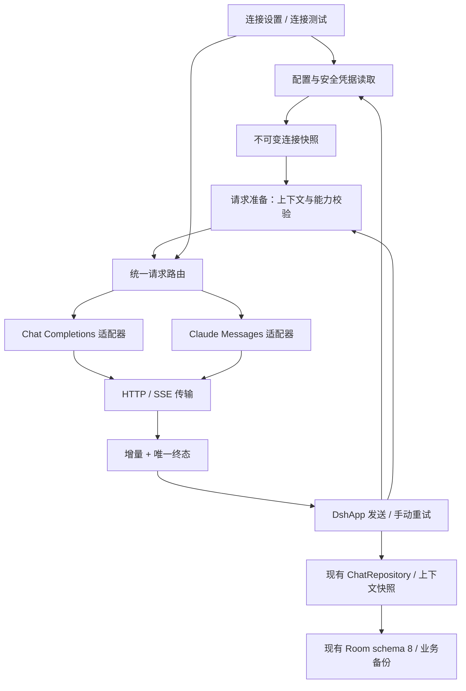

# 布谷笔记 v0.3.0 正式版本规划：多厂商 API 接入

日期：2026-11-07（Asia/Shanghai）。原规划编制时范围待确认；随后用户要求按版本开发文档开始开发，现按推荐范围实施，当前进度与授权见 [实施任务](T-20261107-v31-implementation.md)。以下保留规划时的待确认事项和历史交接，不代表后续状态。

## 文档地位与授权

本文件是下一版本的正式规划入口，版本号 **v0.3.0 为建议值**；当前软件仍是 v0.2.1 / versionCode 13。建议下次交付使用递增的 versionCode（预计 14，打包前核对），本次不改构建配置。这里的“正式”指规划保存位置与交接依据，不表示范围已获确认、技术实测完成或产品已发布。

用户本次要求：根据已完成的需求与技术验证报告，明确功能、暂缓项、模块接口、开发依赖和验收、现有功能与数据风险；保存方案，先检查关键依赖、矛盾与假设，再请用户确认范围，**不要开始编码**。因此本次仅获准静态核对、规划文档及索引；范围确认与开启业务开发分别记录，不能自动接续实施。

依据：[需求记录](T-20261106-multi-ai-access.md)、[技术研究](T-20261106-multi-ai-access-research.md)、[当前状态](../current-state.md)、[产品边界](../product.md)、[现有架构](../../ARCHITECTURE.md)、[质量规则](../quality.md)、[工作流](../workflow.md)、[工程重启计划](000-project-reboot.md)及[备份决定](../decisions/0001-backup-excludes-api-config.md)。历史版本计划不增加本版本承诺。

## 证据结论与推荐范围

**推荐 API 先行：OpenAI + Anthropic/Claude，并兼容保留 DeepSeek、阿里云百炼、OpenAI 兼容自定义连接；暂缓所有产品内订阅账号登录。** 目标是本地用户自带 API Key（BYOK）的 Android 客户端，不引入自建代理、开发者共享 Key 或桌面运行时。

已有研究完成的是官方文档核查和源码分析，未做模型请求、OAuth 或 Android 原型实验。“确认可行”仅到公开协议存在、当前技术栈可承载的设计层面；模型权限、端到端可用性和设备安全性仍未验证。方案允许在完成前置验证后开发，禁止把这些未知标成已通过。

| 本版本候选能力 | 已有依据 | 可交付的边界与通过条件 |
| --- | --- | --- |
| OpenAI API 文本及流式对话 | 已有 provider、Chat Completions 请求和配置链；研究 O1 | 延续 Chat Completions，完成路由、错误、取消及在线模型验收；不将“已有代码”当作本版新增或在线通过 |
| Claude API 文本及流式对话 | 研究 A1/A2/A7 的原生 Messages；现有 HTTP/Flow 可复用 | 新增 Anthropic 专用协议适配；固定 API 版本、输出预算、必要 workspace；不走网页凭据或只改 Base URL |
| 厂商 / 模型选择与 API 计费来源提示 | 需求已确认 API 为必需；已有按厂商设置 | 每厂商一套连接，可手工填写模型 ID；显示当前厂商、模型、API Key 来源、发送目的地；无效模型明确失败，无静默换模型 |
| 项目指令、手动记忆、逐轮引用与附件文本 | 现有上下文快照、持久化链及研究的映射建议 | 两条协议保留内容归属、顺序及项目隔离；不扩展提取格式或预算 |
| 现有单图请求的协议等价映射 | Chat Completions 已有 image_url；Claude 文档有 image content | OpenAI/Claude 各至少一款经实测模型验证文本+单图；沿用现有单图与 6 MB 本地读取上限，叠加厂商更严限制；不承诺任意模型、MIME 或历史图片重放 |
| 连接配置隔离、失败与停止/重试可靠性 | 现有迁移/隔离 fixtures；研究指出流与存储缺口 | 连接测试与聊天共路由，固定一次请求快照，终态唯一，部分输出保存；受影响的旧连接通过回归 |
| API 凭据必要安全收口 | 当前加密失败回退及系统备份未知是明确风险 | 加密不可用时停止凭据读写/请求并提示；补系统备份排除和目的地保护，保持本地笔记可用；具体约定见下文，不能无限扩展为账号安全工程 |

单图是现有聊天能力的兼容要求，不是新增视觉产品。新厂商若图片验证失败，不得静默丢图后发送；应阻止该组合并说明原因。若只能交付纯文本 Claude，属于范围缩减，必须回到本文件请用户确认，不能自行降标。

## 暂缓与排除

| 能力 | 暂缓原因 | 重新进入规划的条件 |
| --- | --- | --- |
| ChatGPT Plus/Pro 等套餐直接登录和额度使用 | 研究记录存在官方预览，但分发资格、Android loopback、令牌生命周期和上下文限制未解决 | 明确分发/收费与地区、官方确认适用、获准隔离移动端实验、安全存储及退出/撤销通过；独立规划，不成为 API 版的依赖 |
| Claude 订阅登录 / Claude Code 或 Agent SDK 额度 | 研究 A4/A5 的适用授权边界未澄清；Android 本地形态无通过证据 | 取得适用于本产品的官方授权依据和明确数据流，再独立评估；不抓取 auth 文件、Cookie、网页令牌 |
| 产品内领取订阅福利、余额查询和精确扣费保证 | API credits 与订阅聊天限额不同；Key 无法证明每次扣款来自福利或付费余额 | 官方提供可验证接口且另行确认范围；本版仅说明 API 可能产生额外费用，福利领取由厂商官网负责 |
| OpenAI 全量 Responses 迁移 | API 主范围无需引入第三条协议；现有 Chat Completions 仍有官方支持 | 明确需要仅 Responses 提供的能力，完成兼容评估；不为后续 OAuth 预建空实现 |
| 新厂商的思考控制、工具调用、联网搜索、语音与深度研究 | 不在已整理 API 基础聊天最小范围内；能力和事件模型各异 | 新需求确认及专门技术验证；现有 DeepSeek 思考/搜索保留，不发送给其他厂商 |
| 多账号、自动路由/故障转移、云同步、自建后端、桌面桥接、模型市场/自动目录 | 扩展凭据、预算与数据流，超出原需求边界 | 独立需求与预算；不借“多厂商”自动纳入 |
| SDK 引入、换栈、拆 Gradle 模块、数据库/备份格式升级、编辑器重构 | 没有本版本必需性证据，兼容成本高 | 出现明确阻塞后停下评估，不顺手实施 |
| 公开商店分发、收费及全球/中国大陆可用承诺 | 地区、软件/品牌许可、正式签名和发布渠道未确认 | 另行确定发行目标并完成资格、许可、签名与设备验收；本规划先以受控本地测试交付为建议边界 |

## 模块关系与接口约定

以下是**拟议逻辑职责**，继续位于现有单一 `:app`，沿用 Kotlin、Compose、Room、HttpURLConnection 和 Flow。确认后仅按本需求抽取必要边界，不等同已经采纳新架构；类型/文件最终命名由实施任务确定，不建立通用插件框架。

设置页测试也须先取得相同的配置快照、能力校验及请求准备；图中的共用 Route 不允许绕开这些步骤。测试只发固定合成短文本，明确告知会使用 API 额度，不带当前笔记/历史；获得正文片段不能提前宣告连接成功，须等完整成功终态。AppContainer 负责装配共用路由；协议适配器只接收请求输入，不访问 UI、DAO 或笔记仓库；Repository 不依赖具体模型客户端。DshApp 仅在现有编排点准备资料、消费事件与调用现有保存，不做无关重构。

| 边界 | 输入 / 输出契约 | 禁止事项与失败处理 |
| --- | --- | --- |
| 配置 → 请求准备 | `provider`、`protocol`、`authKind=apiKey`、base URL、model、可选 workspace、能力配置；凭据仅以受限读取结果进入本次请求 | provider/protocol 不匹配、未知厂商、空 Key/模型、无效地址均在发送前失败；不得把 token 填进 Key 伪装支持订阅 |
| 配置存储 | 保留 deepseek/openai/aliyun/custom 标识及既有分厂商键、DeepSeek legacy 迁移；新增独立 anthropic 键和非敏感参数 | 不覆盖其他厂商，不改写已存地址/模型为“最新默认”；新增/清除只作用选定厂商；不得清除后从 legacy 键复活 |
| 一次请求快照 | 在任何异步保存、搜索或联网前固定厂商、协议、模型、Key 版本、endpoint、workspace、开关、项目/会话、历史和引用；瞬时 request ID 用于隔离回调 | 切换设置不改变在途请求；迟到事件不能写到新会话；日志/消息/备份不含 Key 或整个配置对象 |
| 请求准备 → 协议适配 | 项目指令/记忆、按轮排列的历史 user/assistant、该轮引用资料、用户正文、当前或重试单图分开表达 | 不凭 role 字符串猜测资料信任级别；不新增模型侧工具/自动检索；继续现有上下文裁剪规则和快照预算 |
| 适配器 → HTTP | 适配器负责 endpoint/header/body/事件解码；传输负责超时、资源释放、取消、SSE 分帧 | 认证不进 JSON；不在重定向时转发凭据；POST 发出后不自动重放，不自动改厂商/Key/计费路径 |
| 流 → UI / 持久化 | 有序正文增量，现有支持路径可有思考增量；最终只能有成功、失败、取消或未完成之一 | Failure 后不得 Done 清除错误；EOF 不是成功；输出上限/拒答与网络错误分开提示；停止保存已到正文，忽略终态后的事件 |
| UI → Repository | 沿用现有首条消息事务、草稿及增量保存、已有错误字段与 STOPPED 状态 | 不把所有 DONE 解释为成功；错误需保留 error；不改 Entity、DAO、迁移、快照 JSON、ZIP 格式；状态不足须先评估而非暗改 schema |

### 上下文与能力映射

1. **旧 Chat Completions 链**：在合成 fixture 中保持原请求内容、逐轮引用位置及 DeepSeek 专有思考/搜索条件；通用 SSE 修正的成功/失败判定属于本版可靠性范围，必须回归旧路径。
2. **Claude 链的明确选择**：顶层 system 只放项目指令、手动记忆和应用资料使用规则；每轮笔记引用、选区、附件提取文本放入对应 user 消息的有边界资料块，之后接原用户正文；assistant 回答原序保留。资料声明为外部内容，不提升为顶层指令，不把后轮资料移到前轮。相邻同角色消息如需合并，只合并连续块并保持原序。此为本版新增 Claude 映射提案，须以多轮 fixture 和在线语义场景验证，不声称与旧 prompt 的模型输出完全相等。
3. **快照而非重取**：历史资料使用已保存的 contextSnapshot，遵守原项目校验；笔记后续改动不回写历史引用。沿用最多 8 篇、正文总预算 12,000 字符；不将字符预算说成 token 窗口保证。超上下文限制明确失败，不悄悄删指令或跨项目取资料。
4. **图片**：将现有当前图片和重试图片分别映射为 Chat Completions image_url 或 Claude image/source；历史未保存图片不额外补发。模型/MIME/尺寸/输出预算按已验证能力表校验，未知能力不默认为支持；无支持或原文件缺失时保留草稿/历史并提示，不转发至别厂商。
5. **模型选择**：保留现有可编辑模型输入；每个新增主张支持的厂商至少锁定一款可测的文本/单图模型，记录精确 ID、端点、API 版本、能力、输出上限及核验日期。不把旧默认 gpt-4o-mini 或文档示例当作当前账号有权访问的证据；不自动升级保存的模型。
6. **重试产品语义提案**：使用点击时界面明确显示的当前厂商/模型/API 连接，重新固定快照；原请求的凭据不写进历史数据库。点击“用当前连接重新生成”才发新请求，并提示会重新计费、会发送该对话所含资料。旧回答保留，清 Key 后不从内存旧请求恢复；在途请求仍按其原快照结束。

### 协议与传输底线

- Chat Completions 保留现有 `/chat/completions` endpoint 规则及按厂商参数映射；所选支持契约要求有效 finish_reason 与 `[DONE]`，正常 stop 才成功，length 为未完成，拒答单独提示；不支持的工具结束原因不能算正文成功。截断、已知 error、坏关键 JSON 不能被空列表吞掉后视作成功。V31-01 须以各厂商协议核对该约定，若有合法终结差异先列明厂商契约再实现；自定义服务不符合时显示不兼容，不接受裸 EOF 成功作为通用降级。
- Claude 使用官方 `/v1/messages`、Bearer API Key、显式 `anthropic-version: 2026-10-21`、必需 `max_tokens` 和必要的 `anthropic-workspace-id`。按 index/type 汇总内容块，记录 stop_reason；message_stop 结束且终止原因允许时才成功。输出上限标为未完成、拒答明确提示；未知无害事件可忽略，已知 error 或未支持工具块不得假装完整正文。具体模型参数在任务 V31-01 固定，DeepSeek effort 不盲传。
- SSE 按事件分帧，支持跨读取分片、多行 data、空行、注释/ping、UTF-8 与空白正文；已知结构损坏进入可诊断失败。HTTP 鉴权/权限、余额、限流、过载、模型无权访问与超时有脱敏提示；不直接展示可能回显 Key/笔记的原始服务商错误体。
- 取消须断开连接、结束任务、保存部分输出并保持 STOPPED；重入/迟到 Done 不翻转状态。连接测试和聊天适用相同约定。

### 凭据、地址与备份

- 本版只接用户自带 Key，不内置共享凭据。默认官方连接使用对应官方 HTTPS host；百炼按已核验地区端点。现存代理地址不能悄悄覆盖：标记为需用户确认的自定义目的地，确认前不发送；用户明确绑定该地址与专用凭据后方可继续。此确认只增加该连接的目的地信任记录，不将旧 provider 配置搬到唯一 custom 配置槽，也不覆盖已有 custom。自定义仍保留兼容能力，不宣称由官方验证。
- 新保存必须成功写入既有加密存储；加密初始化/解密失败时不回退读取/写入普通偏好、不发请求，给出重新配置提示。已有 fallback 文件不自动删除、搬迁或输出；加密恢复后由用户重新输入，删除旧凭据需明确操作。此收口可能使少数设备上的旧连接暂不可用，但笔记、聊天历史与附件继续可用；这是需要用户确认的兼容取舍。
- “清除此厂商 Key”须取消该厂商在途请求，清除对应安全存储键及对应 legacy/fallback 凭据键，其他厂商保留；不得自动复活旧 Key。用合成存储验证中断/失败并如实提示部分清理失败，不读取真实偏好做实验。
- 维持自有业务备份排除 API 配置；Android 系统备份/设备迁移须覆盖 API 26—30 与 API 31+ 的对应规则，明确排除 secure/fallback 凭据文件和实现实际产生的可备份加密元数据，并核对不可迁移的 Keystore 密钥在恢复后的行为；不能把 allowBackup=true 或 ZIP 排除当作充分证据。规则和故障场景先在隔离安装、合成数据验证；不得关闭整个应用业务备份来规避测试。
- 不宣称 BYOK 能达到服务器密钥保密程度；公开发行需另行评审。任何涉及真实凭据清理、用户安装覆盖或真实数据替换的操作，先准备具体保护/回退并取得相应批准。

## 前置审查：关键依赖、矛盾和无法验证的假设

| 编号 / 发现 | 处置及可验证证据 | 阻断位置 / 当前状态 |
| --- | --- | --- |
| B1：报告名义“验证”可能被当作在线实测 | 本文件明确仅文档/静态可行；V31-01 锁协议，V31-07 完成真实测试连接 | 不阻断确认 API 范围；阻断宣称在线支持或发布，未解决 |
| B2：订阅是原条件目标，却依赖未确认资格 | 本版暂缓两家订阅登录，API credits 仅作为 API 使用说明；需求原文不改写为已满足 | 等待用户接受暂缓；接受后不再是 API 版关键依赖 |
| B3：首发模型、地区、测试账号/预算未确认 | 先按“手工模型 ID + 实测白名单”规划；V31-01 依据官方文档列精确候选、可支持地区；在线前由用户确认测试配置和费用上限 | 阻断模型相关生产实现定稿及 V31-07；不能用“任意模型可用”补洞 |
| B4：上下文提升会改变引用的权限和时序 | 采用上述 Claude 逐轮 user 资料块映射；旧链保持原序；V31-03 验证双轮引用、同名/改名快照和项目切换 | 契约已提出，待范围确认和实现验证；不再依赖“只换 JSON 字段”假设 |
| B5：新增厂商却沿用明文回退/系统备份未知 | 安全收口为本版必要任务 V31-02；设备规则与失败场景列入 V31-07 | 阻断使用真实测试 Key 和候选交付；方案已列，未实测 |
| B6：保留旧配置与限制官方 host 存在冲突 | 不改写地址，不删除配置；非官方历史地址明确确认目的地后走自定义边界；安全存储失效提示重新配置 | 兼容取舍待用户确认；V31-02 验证，不承诺所有旧代理无感继续用 |
| B7：无 Room 迁移却可能想展示历史模型/费用 | 本版仅展示当前/在途连接，不声称旧回答的模型来源；重试使用当前连接并明确标识，不新增历史字段 | 已从范围排除；若要求历史归因，需重开数据/备份兼容评估 |
| B8：环境仅有离线依赖，无设备/在线证据 | 编译和合成测试先行；设备/在线未获准或不可用时如实记“未执行/环境受阻” | 阻断 V31-07/08 完成，不能仅凭 baseline 发布 |
| B9：数据风险基线仍有未覆盖历史链 | 保留 R03 未完成项；V31-06 对当前变更验证 schema/备份未变、旧数据链回归；V31-07 用合成 v0.2.1 资料更新演练 | 不阻断文档确认或隔离开发；阻断“全部历史数据已验证”或真实覆盖安装承诺 |
| B10：公开分发资格/许可/签名未知 | 首个目标限定受控本地测试；不以本地 Git 等同开源；公开发布另立任务 | 用户若要求商店/公开发行，本规划不能直接放行 |

审查结果：未发现必须先实现订阅登录、引入后端或改变数据库才能完成 API 版本的依赖；开发图可串行执行，无循环依赖。**仍有明确的开工/发布门槛，不是“无阻塞、可以立即编码”**。其中范围确认、模型契约和安全方案未关闭前不得进入对应实现；没有在线条件时只交付离线候选，不能把 V31-07/08 勾为完成。以上判断来自静态设计审查，不是本次产品实验。

## 开发顺序、依赖和逐项验收

以下是待确认工作包，均未开始；确认范围并单独开启产品开发后，再由接手会话按[任务格式](README.md#可复制的任务格式)建立实际任务、认领允许路径。不开空任务文件，不安排并行写入；DshApp 及配置/上下文链由同一集成人串行集成。

| 顺序 / 任务 | 依赖 / 主要范围 | 验收标准及证据 |
| --- | --- | --- |
| V31-00：确认与开工基线 | 本规划；仅文档/状态核对 | 用户确认推荐范围和兼容取舍，并另有明确产品开发授权；核对当前 Git 和已有修改、单一写入者、保护清单及质量入口，范围/授权两项分别落任务；否则停在规划 |
| V31-01：冻结模型、协议和验证矩阵 | V31-00；契约文档与合成场景设计 | 列出 OpenAI/Claude 各至少一个候选精确模型 ID、文本/图像能力、endpoint/API version/workspace 条件、输出预算；官方来源和日期可追溯；确认本地测试目标及可用地区，列出在线/设备授权缺口；Claude 上下文和重试语义无待定分支，不用示例模型代替权限证据；未满足不得开始 V31-03/04/05 |
| V31-02：配置与安全存储边界 | V31-01；ApiConfig/设置错误状态、Manifest/备份规则及相关测试 | 合成旧 DeepSeek legacy + 四厂商配置升级/重启/切换/清除互不覆盖；新增 Anthropic 独立保存；Keystore 故障不落明文/不发送；自定义目的地、302 跨 host、清 Key 取消/不复活、失败保留其他配置均验证；系统规则静态检查通过，设备实测留 V31-07；assembleDebug/lintDebug、network021 和受影响生命周期回归通过 |
| V31-03：请求准备与统一路由 | V31-01、V31-02；data 请求边界及最小调用点 | 设置测试/发送/重试共用工厂；双轮引用/附件/记忆/指令顺序、资料边界、项目隔离、图片能力、异步切换快照有合成断言；旧 Chat Completions 请求 golden/语义比较无无意变化；不支持组合在持久化消耗草稿前失败；构建/Lint、network021、lifecycle019 通过 |
| V31-04：Claude 原生 Messages | V31-03；请求/头/图片映射、事件解码 | 文本、多轮、图片、workspace 和输出预算请求正确；文本多块按 index 顺序、ping/未知事件、error、拒答、上限、截断、损坏事件、取消覆盖；header 版本明确、无 DeepSeek 参数/Key 泄漏；合成 HTTP/SSE 集成及构建/Lint、network021 通过；在线成功不在此虚报 |
| V31-05：旧协议与统一流终态 | V31-04；现有客户端/传输/SSE、相关回归 | 旧四厂商 fixture 保留；多行/拆帧/空白/Unicode、401/403/余额/429/5xx/超时、正文后 error、Failure 后 Done、无终结 EOF、取消后迟到回调全部有结果断言；一次终态，POST 无自动重放/换 Key；部分输出保留；构建/Lint、network021、lifecycle019 通过 |
| V31-06：设置及聊天集成、升级兼容 | V31-05；ApiSettingsScreen/DshApp 与合成持久化场景 | 当前厂商/模型/API 来源及目的地可见；测试等待真终态；跨厂商提示会发送历史及引用资料；重试明确用当前连接且旧回答保留；缺配置/不支持图像不丢草稿；项目切换、停止、进程重建后不串会话；旧 schema 8 合成库/备份往返及附件哈希一致，API 配置不进 ZIP，无数据库迁移；旧厂商实际请求分流均断言 |
| V31-07：隔离设备与获准在线验收 | V31-06；安全验证合格，设备/账号/地区/费用条件已落实 | 用无真实数据的隔离测试安装验证 API 26—30 与 31+ 备份排除/安全存储故障、中文输入、设置重启、项目切换、取消及进程恢复；OpenAI/Claude 各选定模型做短文本、两轮指令与引用、合成单图、手动重试；DeepSeek/百炼在可用测试配置下验保留链，自定义仅对明确选定兼容服务承诺；每项记录实测或受阻，不能拿 HTTP 200/fixture 代替回答与持久化验收；无敏感日志且费用不超授权预算 |
| V31-08：集成验收与受控候选交付 | V31-07 全部必需场景通过；最终单一源码 | 全新隔离副本 `python3 tools/check.py baseline` 全套通过无隐瞒跳过，警告区分已有/新增；核对版本/身份/资源、APK 哈希与公有签名证书；发布说明列已测模型/地区/设备和限制，用户体验验收单独记录；只交付获准测试候选，不自动安装覆盖、签名变更、公开发布或推送 |

依赖：`V31-00 → V31-01 → V31-02 → V31-03 → V31-04 → V31-05 → V31-06 → V31-07 → V31-08`。为避免共同网络/编排点冲突，先串行闭环再考虑优化分工；没有强制并行需求。V31-02 的系统备份设备结果及所有在线验证在 V31-07 关闭，未关闭前不得使用真实 Key 开始联调。

验证命令及环境复用 [quality](../quality.md)，均由 Codex 在隔离副本执行。涉及网络/聊天至少构建、Lint、network021、lifecycle019；涉及备份边界按质量矩阵加迁移/ZIP 与相应生命周期检查。新增回归机制或发布交付使用完整 baseline；缺离线缓存、设备或测试凭据时记录受阻，不安装新依赖或操作真实数据补足。

验收证据至少包括：源码提交及未提交输入哈希、任务/用例 ID、时间、JDK/SDK、隔离目录、命令/退出码、预期和实得结果、报告位置、未执行原因；在线另记供应商/协议/精确模型/API 版本、测试地区与脱敏账号类型、预算和实际费用可确认程度。不写 Key、正文原件或附件原件。当前所有 V31 实施验收均为“未执行”。

## 现有功能与用户数据风险、回退

| 风险 / 影响链路 | 防护及停止条件 | 回退边界 |
| --- | --- | --- |
| 配置键/凭据迁移错误导致旧连接失效或串 Key | 只增独立配置与必要校验；合成迁移、清除/重启/加密失败矩阵；任何串 Key 阻止集成 | 撤销该任务源码增量，保留原配置；不自动恢复/导出真实凭据；安全收口后的降级可能重新暴露旧明文行为，不能把旧 APK 当安全回退保证 |
| 选错厂商会把本地历史、记忆、附件发往新目的地 | 固定快照、展示当前目的地和重试语义、跨厂商提示；无静默路由/搜索 | 中止请求，保留草稿/历史；已经发到厂商的数据无法本地撤回，不以撤代码承诺撤回远端数据 |
| HTTP 重定向/错误回显或系统备份泄漏 Key | 固定凭据目的地、拒绝跨域转发、脱敏、分 API 级别备份排除与 Keystore 故障演练 | 发现泄漏先停止联调/交付；相关测试 Key 在厂商侧撤销需按当时授权处理，禁止输出值 |
| Claude 上下文映射改变回答或混入项目资料 | 逐轮块/快照、项目验证、两轮语义用例；旧链 fixture 防退化 | 回退 Claude 适配或继续暂缓；不修改已有笔记、快照和历史正文纠正请求 |
| 流结束/取消错误造成回答丢失、假成功或重复收费 | 唯一终态、部分保存、无自动重放、会话/request ID 约束；停止/切换/进程测试 | 保留已保存消息并展示错误，禁止清历史“恢复”；不保证取消能撤销已发生的厂商计费 |
| DshApp 共用链回归影响草稿、项目、搜索、图片 | 最小调用点改动、lifecycle/network 及设备场景；DeepSeek 搜索保留专属分支 | 回退当前任务调用改动并重验；不波及编辑器、双链、删除规则或品牌资产 |
| 安全收口让 Keystore 异常设备无法继续 API | 明确提示、笔记照常使用；fallback 不静默删除/迁移，设备实测 | 记录限制并修复安全初始化；不以自动退回明文为恢复手段；该体验取舍须用户确认 |
| 备份/迁移或安装覆盖导致真实数据被替换 | 维持 applicationId、数据库名、schema 8、迁移 1→8 和业务备份格式/排除边界；仅用测试库/归档验证 | 本版无业务格式升级，回退仍先保护数据并核对源码/APK/签名；禁止卸载重装、破坏性建库或用恢复备份“试一下” |
| 启动清理回收站、历史升级与附件风险既有 | 不启动真实应用；R03 的未覆盖历史链保持未确认；隔离库含草稿/回收站/引用/附件/旧备份 | 有数据不一致即停止集成，保留测试现场，不改变业务实现绕开失败；超出本版的问题另行登记 |

本版本不以“顺便修复”方式处理同名双链、永久删除事务、完整历史迁移链等既有问题。若这些问题成为候选交付的直接阻碍，先登记证据、缩小阻碍范围并重新安排，不暗中扩大业务改动。

## 范围确认单与后续会话入口

规划编制时建议用户一次确认以下组合；后续本版的授权依据和当前进度见[实施任务](T-20261107-v31-implementation.md)：

1. 下一版本暂定 v0.3.0，目标为受控本地 BYOK 测试交付：OpenAI API + Claude 原生 API，保留 DeepSeek/百炼/custom；含文本、流式、现有引用/附件文本及单图兼容，不承诺任意模型。
2. 两家订阅登录暂缓；API 福利只按普通 API 计费解释，不提供余额/额度保证；暂不公开分发。
3. 接受必要安全收口及其兼容代价：Keystore 异常时停止 API、历史非官方地址需确认；手动重试用界面当前连接并保留旧回答。

当时拟议的单独范围确认本身不等于开启编码、设备安装或付费测试；后续用户已要求开始开发，依据见实施任务。模型候选、可支持地区与安全用例由 Codex 在 V31-01 提供具体清单；在线前再落实测试账号/凭据、费用上限和隔离设备授权，不要求用户现在操作终端或提交 Key。若用户希望本版必须使用订阅登录，本推荐方案不能满足，应继续解决 B2 而不是伪装 API 扣订阅额度。

后续会话先读本文件、关联需求/研究及任务索引，核对磁盘/阶段；只确认范围时更新确认依据和状态，仍停止在规划。收到明确产品开发授权后执行 V31-00，关闭 V31-01 前置再逐项开发；不得依据本规划自动认领业务写入。若改模型策略、计费来源、数据格式、发行目标或图片验收边界，先更新本文件和依赖审查，再继续对应任务。

## 本次规划任务记录与交接

- 起止基线：`main / 708a7f0`，暂存差异为空；已有 `.gitignore`、任务索引、workflow、检查工具及自检、`.agents/` 和四个 T 任务的未提交差异。相关任务均记载停止写入；本次保留已有内容，仅写本规划文件及索引新增行。不提交、不切分支、不推送。
- 允许修改：本文件及索引新增规划行。原需求、研究、产品/当前架构、ADR、业务代码、依赖、版本、真实数据与凭据均不修改。前副本与文件 SHA-256 在 `/tmp/bugu-next-version-plan-20261107-before/`，仅作本轮保护，不能当长期备份。
- 最小步骤：读需求/研究/工程状态 → 核对代码链和必要官方协议 → 写候选范围/契约/依赖/验收/风险 → 审查矛盾和假设 → 文档及保护检查 → 请求范围确认。
- 2026-11-07 开工在项目根执行 `python3 tools/check.py quick`，退出 0：45 份文档、342 个本地链接、25 项资产通过。本次仅文档，无需业务 baseline、构建或回归；设备/在线/真实数据均未执行，不作为通过。
- 本次追加核对官方资料：OpenAI 官方[迁移指南](https://developers.openai.com/api/docs/guides/migrate-to-responses)继续支持 Chat Completions；Claude [Messages](https://platform.claude.com/docs/en/api/messages/create)和[认证](https://platform.claude.com/docs/en/manage-claude/authentication)支持本方案所选公开协议及认证，[流式文档](https://platform.claude.com/docs/en/build-with-claude/streaming)要求处理事件/终止/错误。读取日期为 2026-11-07，不等于账号或设备实验。订阅资格和福利细节仍引用 2026-11-06 研究，不在本次声称重新验证；进入相关工作时须重核官方资料。
- 收尾检查：在项目根执行 `python3 tools/check.py quick`，退出 0：46 份文档、354 个本地链接、25 项资产通过；`git diff --check`、`git diff --cached --check` 均退出 0。相对链接、版本现状/建议、任务依赖、规划/实施状态及验收可观察性已人工核对。开工 190 项文件哈希中仅索引有本次允许增量，其他 189 项完全不变；索引对前副本只增加本规划一行，另有本规划新文件；Android、Web、设计的 Git 差异为空，原需求/研究及其他未提交内容保持不变。
- 交接：文档编制和关键依赖审查完成，范围和 V31 实施任务待决定/未执行；下一步只请用户确认上述范围组合，确认后先记依据，仍不编码。检查进程已退出，未启动应用、构建、服务、设备测试或在线模型请求，未操作真实凭据/数据；本会话停止写入并释放范围，其他会话进程状态未确认。已有功能、用户数据和实际软件版本均未改变。
- 回退仅删除本次规划新增文件及索引新增行；若已发生后续修改，逐项审查增量，不覆盖索引原有四行或使用 reset/clean。本次没有可回退的业务行为/真实数据变动。
