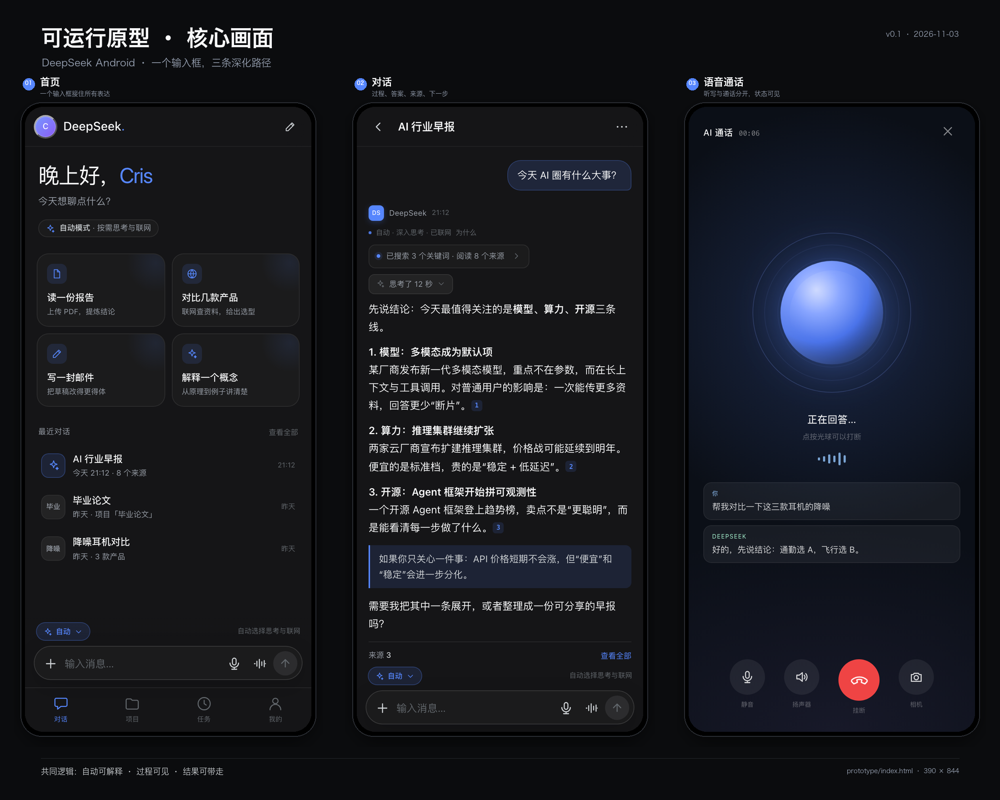

# DeepSeek Android 原型 · 可运行版

> 一个手机优先、可直接在浏览器里跑的交互原型。视觉语言参考 DeepSeek Harness：中性偏蓝的灰阶、Montserrat 标题、细边框、16px 圆角、DeepSeek 蓝 `#5686FE`。



## 运行

```bash
cd prototype
python3 -m http.server 4173
```

打开 <http://127.0.0.1:4173>。

- 桌面端会在一个 390 × 844 的设备框里展示；窗口宽度 ≤ 720px 时自动变成全屏移动布局。
- 也可以直接在 Android Chrome 里打开，使用“添加到主屏幕”获得接近 App 的全屏体验（含 manifest / service worker）。
- 所有 AI 输出、文件解析、任务执行、分享/导出都是**模拟数据**，不会调用真实 API。

## 已实现的交互

| 区域 | 可操作 |
| --- | --- |
| 首页 | 时段问候、建议卡、最近对话、自动模式入口、抽屉历史 |
| 输入框 | 文字、模式面板（思考深度/联网/回答风格）、听写模拟、语音入口、附件、发送/停止 |
| 对话 | 模拟流式输出、停止/继续、重新生成、多版本切换、思考过程展开、搜索过程、行内引用、来源详情、记忆使用、复制/分享/朗读/反馈 |
| 多模态 | 示例图片理解、示例 PDF 解读、图片预览、文件卡、页码引用（演示） |
| 语音 | 全屏通话、连接/聆听/思考/说话状态、字幕、打断、静音/扬声器/挂机、结束后转写回对话 |
| 深度研究 | 输入主题 → 研究计划 → 四阶段进度 → 可滚动报告（目录/来源/导出） |
| 项目 | 列表、项目详情、指令、资料、项目内对话、新建项目、添加资料 |
| 任务 | 列表、启停、自然语言创建 + 确认卡、立即运行、运行历史 |
| 记忆 | 开关、按类型列出、新增/编辑/删除、来源说明、回答内的“使用了 N 条记忆” |
| 设置 | 深/浅主题、字号、自动联网、记忆、后台通话、清缓存、重置演示数据 |
| 其他 | 分享长图/链接/PDF 预览、画布草稿、项目资料、来源下钻、⌘K 打开抽屉、Esc 关闭浮层 |

## 建议的评审路径

1. 首页 → 点“对比几款产品” → 看自动联网、思考、表格、来源。
2. 首页 → “+” → “示例图片” → 发送 → 看图片理解与附件预览。
3. 首页 → “+” → “示例 PDF” → 发送 → 看文件卡与页码引用。
4. 左上角头像 → 历史抽屉；或按 `⌘K`。
5. 左栏 “03 语音通话” → 等 5 秒 → 点光球打断 → 挂断 → 看转写。
6. 左栏 “04 深度研究” → 生成计划 → 开始研究 → 看报告。
7. 左栏 “05 项目” → 毕业论文 → 项目指令 / 资料 / 对话。
8. 左栏 “06 任务” → 新建任务 → 输入“每天早上 8 点…” → 确认卡。
9. 左栏 “08 设置” → 切浅色 / 调字号 / 重置演示数据。

## 文件结构

```
prototype/
├── index.html          # 外壳、SVG 图标 sprite、舞台/设备框
├── styles.css          # 设计 token、全部界面样式、响应式、动效
├── app.js              # 状态、种子数据、渲染、流式、语音、研究、事件
├── manifest.webmanifest
├── sw.js               # network-first，离线兜底
├── assets/
│   ├── fonts/          # 从 DSH 提取的 Montserrat（OFL）
│   ├── icon-192.png / icon-512.png / icon.svg
│   └── demo-chart.png  # 示例图片理解
└── screens/overview.png
```

## 从原型到 Android

这一版刻意用**无依赖的 Web 技术**做交互验证，结构上对应 Android 侧的实现：

| 原型 | Android 对应 |
| --- | --- |
| `.screen` 路由 | Navigation Compose + 单 Activity |
| `state` + `render()` | ViewModel + UiState（MVI） |
| `setInterval` 流式 | OkHttp SSE + Flow，40ms 批量刷新 |
| `openOverlay(sheet)` | ModalBottomSheet |
| 全屏 `.voice` | Compose 全屏 + Foreground Service（麦克风） |
| localStorage | Room + DataStore |
| manifest / SW | PWA 安装；正式版可用 TWA/Capacitor 过渡，最终原生 |

如果下一阶段转原生，建议先按 `styles.css` 的 token 建 Compose Theme，再逐屏替换；交互状态机（尤其语音、研究、任务）可以直接复用本文档的流程。

## 已知边界

- 不接真实模型/搜索/文件解析；所有结果来自内置脚本。
- 语音是状态模拟：没有真实麦克风采集、ASR、TTS。
- 任务不会真的在后台执行；研究进度是定时器。
- 分享/导出只展示预览与 toast，不生成真实文件。
- 模式设置目前是全局的；正式版应按对话保存。
- 仅针对手机宽度做了完整适配；平板/折叠屏是下一阶段。
